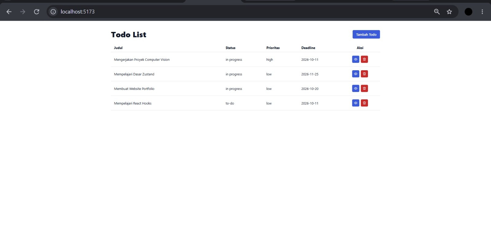
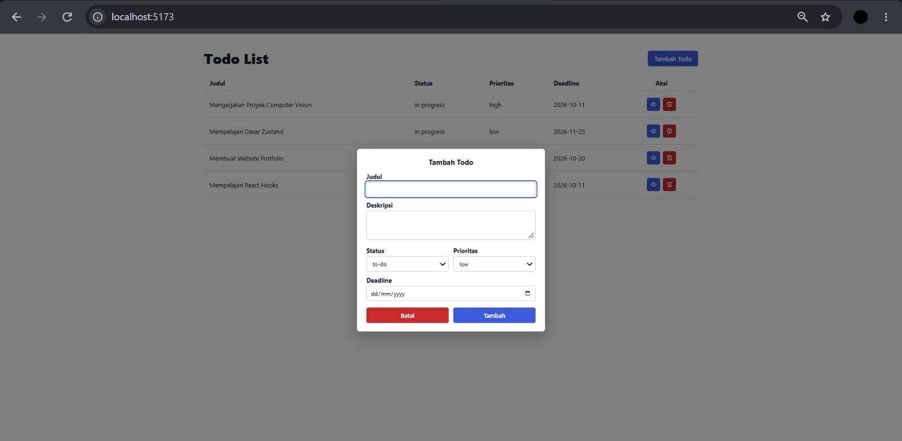
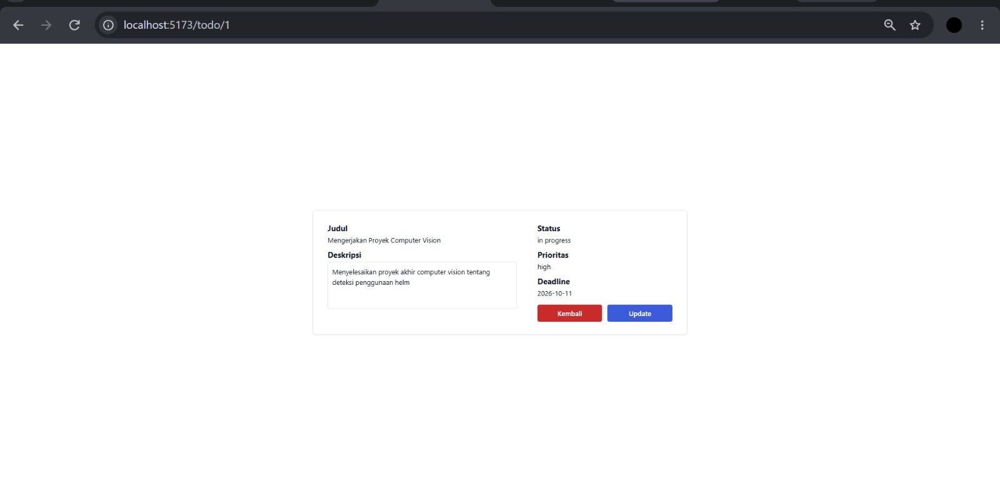
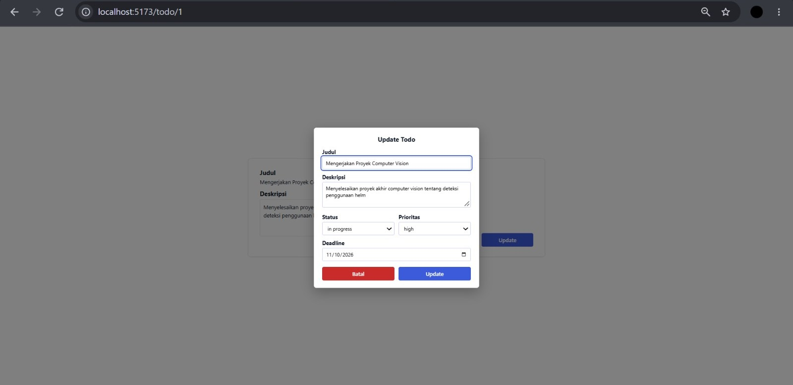
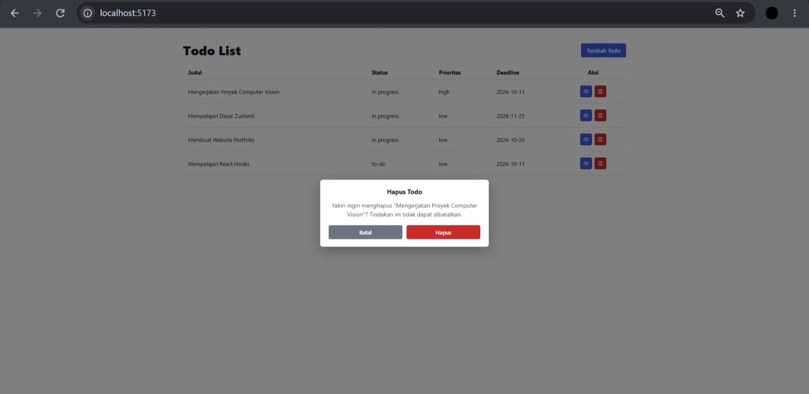

# Todo List – React.js

## Fitur

- **Menampilkan tugas** – tabel berisi judul, status, prioritas, deadline, dan aksi.
- **Melihat detail** – klik ikon mata untuk membuka halaman `/todo/:id`.
- **Menambah tugas** – tombol "Tambah Todo" membuka formulir modal (dengan validasi).
- **Memperbarui tugas** – tombol "Update" pada halaman detail.
- **Menghapus tugas** – ikon tempat sampah, disertai dialog konfirmasi.
- **Umpan balik** – notifikasi (toast) setelah tambah, update, dan hapus.
- Seluruh perubahan langsung tampil tanpa reload halaman.

## Screenshot

| Daftar Todo | Tambah Todo |
| --- | --- |
|  |  |

| Detail Todo | Update Todo |
| --- | --- |
|  |  |

| Konfirmasi Hapus |
| --- |
|  |
